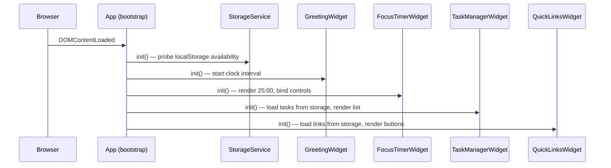
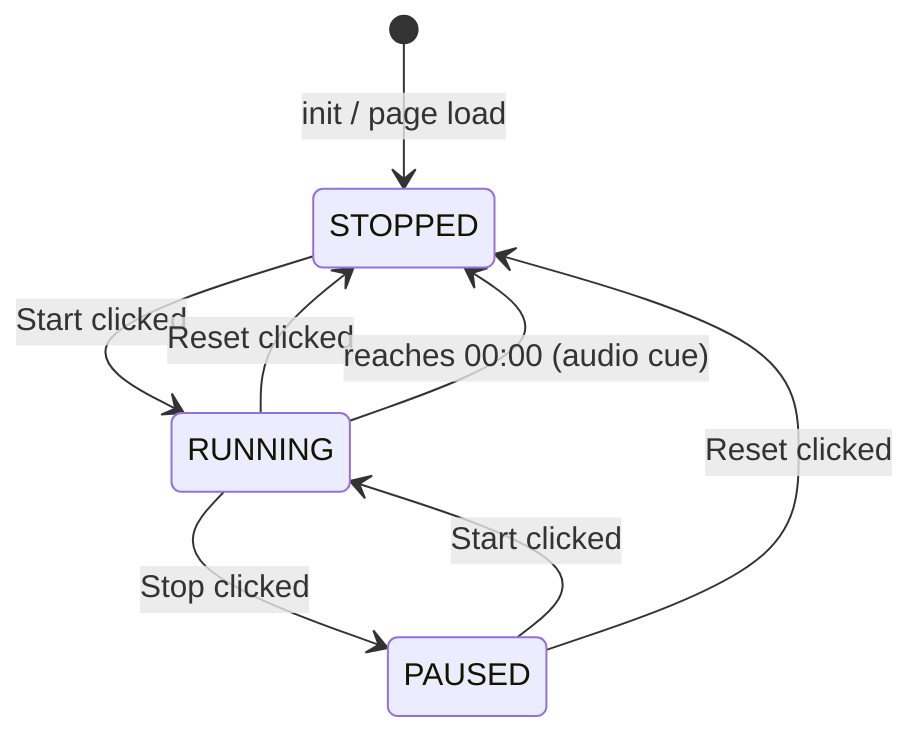
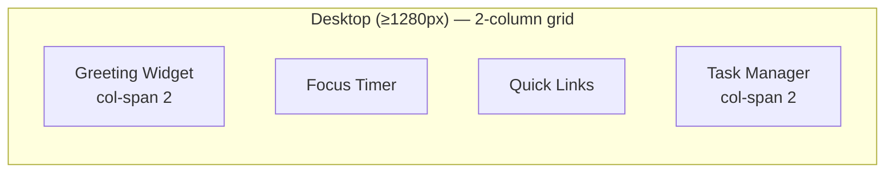

# Design Document

## Overview

The To-Do Life Dashboard is a single-page web application built with plain HTML, CSS, and Vanilla JavaScript. It provides four interactive widgets — a greeting/clock display, a Pomodoro focus timer, a to-do task manager, and a quick-links launcher — all on one screen with no backend, no build step, and no external dependencies. All user data is persisted in the browser's `localStorage` API.

The design philosophy is deliberate minimalism: one HTML file, one CSS file, one JS file. The JavaScript is organized using the **Revealing Module Pattern** — each widget is encapsulated in its own IIFE-based module object, coordinated by a thin `App` bootstrap module that initializes all widgets on `DOMContentLoaded`.

### Key Design Goals

- **Zero dependencies**: no CDN scripts, no npm packages, no frameworks.
- **Instant load**: static files served directly from disk or a simple HTTP server.
- **Offline-capable**: everything runs in the browser; no network calls after initial load.
- **Accessible**: semantic HTML, ARIA attributes where needed, keyboard-navigable controls.
- **Maintainable**: each widget is a self-contained module; adding or removing one does not affect the others.

---

## Architecture

### File Structure

```
project-root/
├── index.html        # Single entry point; defines widget markup shells
├── css/
│   └── style.css     # All styling — layout grid, widget cards, typography, responsive
└── js/
    └── app.js        # All logic — modules for each widget + App bootstrap
```

### Module Architecture

`app.js` is organized as a collection of module objects, each exposing only a public `init()` method. All internal state is private to the module closure.

```
app.js
├── StorageService       — thin wrapper around localStorage (read/write/error handling)
├── GreetingWidget       — clock, date, contextual greeting
├── FocusTimerWidget     — countdown logic, control state machine, audio cue
├── TaskManagerWidget    — CRUD operations, validation, DOM rendering for tasks
├── QuickLinksWidget     — link CRUD, validation, DOM rendering for links
└── App                  — DOMContentLoaded bootstrap; calls init() on each widget
```

### Initialization Sequence



### Widget Independence

Each widget queries the DOM for its own root element (`document.getElementById`) and attaches event listeners only within that subtree. No widget has a reference to another widget — they communicate only through the shared `StorageService`.

---

## Components and Interfaces

### StorageService

Wraps `localStorage` so that all read/write operations go through a single error-handling boundary. On any `SecurityError` or `DOMException`, it sets a module-level `available` flag to `false` and surfaces a user-visible banner.

```javascript
StorageService = {
  init(),                        // probe availability; show banner if unavailable
  get(key)   → any | null,       // JSON.parse; returns null on missing/invalid
  set(key, value) → boolean,     // JSON.stringify; returns false on QuotaExceededError
  isAvailable() → boolean
}
```

**Storage keys:**

| Key              | Value type     | Widget         |
|------------------|----------------|----------------|
| `tld_tasks`      | `Task[]`       | TaskManager    |
| `tld_links`      | `Link[]`       | QuickLinks     |

### GreetingWidget

Owns a single `setInterval` running every 1000 ms. On each tick it reads `new Date()`, formats the time and date strings, determines the greeting tier, and updates three DOM text nodes. No state is persisted.

```javascript
GreetingWidget = {
  init(),                                  // start interval, render immediately
  _tick(),                                 // called by interval
  _formatTime(date) → string,              // "HH:MM:SS"
  _formatDate(date) → string,              // "Tuesday, January 27, 2026"
  _getGreeting(hour) → string,             // "Good Morning" | "Good Afternoon" | ...
  _render(time, date, greeting)            // update DOM text nodes
}
```

### FocusTimerWidget

Manages a state machine with three states: `STOPPED`, `RUNNING`, `PAUSED`. The single `setInterval` handle is stored in a closure variable; it is cleared on pause, stop, or completion.

```javascript
FocusTimerWidget = {
  init(),                                  // render 25:00, set STOPPED state, bind buttons
  _start(),                                // STOPPED|PAUSED → RUNNING
  _stop(),                                 // RUNNING → PAUSED
  _reset(),                                // any → STOPPED, restore 25:00
  _tick(),                                 // decrement seconds, check completion
  _playAudioCue(),                         // AudioContext beep, 1–2 seconds
  _renderDisplay(totalSeconds),            // format MM:SS, update DOM
  _updateControlState(state)               // enable/disable buttons per state
}
```

**Timer state machine:**



### TaskManagerWidget

Manages an in-memory `Task[]` array that is the single source of truth. Every mutation saves the full array to `StorageService` before updating the DOM.

```javascript
TaskManagerWidget = {
  init(),                                  // load from storage, render all tasks
  _addTask(description),                   // validate → push → save → render
  _editTask(id, newDescription),           // validate → mutate → save → render
  _deleteTask(id),                         // splice → save → render
  _toggleComplete(id),                     // flip status → save → render
  _renderList(),                           // rebuild DOM from in-memory array
  _renderTask(task) → HTMLElement,         // create <li> with all controls
  _enterEditMode(id),                      // replace text node with <input>
  _exitEditMode(id, save),                 // confirm or cancel edit
  _showValidationMessage(msg),             // display inline error near input
  _clearValidationMessage()
}
```

### QuickLinksWidget

Mirrors the TaskManager pattern but for `Link` objects. The maximum of 20 links is enforced at submission time.

```javascript
QuickLinksWidget = {
  init(),                                  // load from storage, render all links
  _addLink(name, url),                     // validate → push → save → render
  _removeLink(id),                         // splice → save → render
  _renderList(),                           // rebuild DOM from in-memory array
  _renderLink(link) → HTMLElement,         // create <button> + remove control
  _validateUrl(url) → boolean,             // must start with http:// or https://
  _showValidationMessage(field, msg),
  _clearValidationMessages()
}
```

---

## Data Models

### Task

```javascript
/**
 * @typedef {Object} Task
 * @property {string}  id          — UUID v4 generated at creation time
 * @property {string}  description — 1–200 characters, trimmed
 * @property {boolean} completed   — false on creation
 * @property {number}  createdAt   — Date.now() timestamp
 */
```

Example JSON stored in `localStorage`:

```json
[
  {
    "id": "a1b2c3d4-e5f6-7890-abcd-ef1234567890",
    "description": "Review pull request #42",
    "completed": false,
    "createdAt": 1706400000000
  }
]
```

### Link

```javascript
/**
 * @typedef {Object} Link
 * @property {string} id        — UUID v4 generated at creation time
 * @property {string} name      — 1–50 characters, trimmed
 * @property {string} url       — valid URL starting with http:// or https://, max 2048 chars
 * @property {number} createdAt — Date.now() timestamp
 */
```

Example JSON stored in `localStorage`:

```json
[
  {
    "id": "f9e8d7c6-b5a4-3210-fedc-ba0987654321",
    "name": "GitHub",
    "url": "https://github.com",
    "createdAt": 1706400000000
  }
]
```

### UUID Generation

Since the app targets modern browsers only and avoids polyfills, Task and Link IDs are generated using `crypto.randomUUID()` (available in all modern browsers). A simple fallback using `Math.random()` is provided for environments where `crypto` is unavailable.

```javascript
function generateId() {
  return (typeof crypto !== 'undefined' && crypto.randomUUID)
    ? crypto.randomUUID()
    : Math.random().toString(36).slice(2) + Date.now().toString(36);
}
```

---

## Visual Design

### Layout

The page uses a CSS Grid layout. On desktop (≥1280px) the four widgets are arranged in a **2×2 grid**. On tablet (768–1279px) they collapse to a **single-column** flow to avoid crowding. On mobile (<768px) they stack in a single column.

```
┌─────────────────────────────────────────┐
│           GREETING / CLOCK              │  ← full width (col-span: 2)
├─────────────────────┬───────────────────┤
│    FOCUS TIMER      │   QUICK LINKS     │
├─────────────────────┴───────────────────┤
│           TASK MANAGER                  │  ← full width (col-span: 2)
└─────────────────────────────────────────┘
```



### Color Palette

| Token               | Value                             | Usage                        |
|---------------------|-----------------------------------|------------------------------|
| `--bg-gradient`     | `linear-gradient(135deg, #667eea 0%, #764ba2 100%)` | Page background |
| `--card-bg`         | `#ffffff`                         | Widget card background       |
| `--card-shadow`     | `0 8px 32px rgba(0,0,0,0.15)`     | Card elevation               |
| `--text-primary`    | `#2d3748`                         | Main text                    |
| `--text-secondary`  | `#718096`                         | Labels, timestamps           |
| `--accent`          | `#667eea`                         | Buttons, links, highlights   |
| `--accent-hover`    | `#5a6fd6`                         | Hover state for accent       |
| `--danger`          | `#e53e3e`                         | Delete, error messages       |
| `--success`         | `#38a169`                         | Completed task text          |

### Typography

- Font stack: `'Segoe UI', system-ui, -apple-system, sans-serif`
- Clock display: `clamp(2.5rem, 5vw, 4rem)`, font-weight 700
- Date/greeting: `1.1rem`, font-weight 400, `var(--text-secondary)`
- Widget headings: `1.25rem`, font-weight 600
- Body/task text: `1rem`, line-height 1.5

All color combinations meet WCAG 2.1 AA requirements: white text on `--accent` (#667eea) yields a contrast ratio of approximately 4.6:1 for normal text; `--text-primary` (#2d3748) on white card background yields approximately 10:1.

### Responsive Breakpoints

```css
/* Desktop: 2-column grid */
@media (min-width: 1280px) { .dashboard-grid { grid-template-columns: 1fr 1fr; } }

/* Tablet: single column */
@media (min-width: 768px) and (max-width: 1279px) { .dashboard-grid { grid-template-columns: 1fr; } }

/* Mobile: single column, reduced padding */
@media (max-width: 767px) { .dashboard-grid { grid-template-columns: 1fr; padding: 0.75rem; } }
```

---

## Correctness Properties

*A property is a characteristic or behavior that should hold true across all valid executions of a system — essentially, a formal statement about what the system should do. Properties serve as the bridge between human-readable specifications and machine-verifiable correctness guarantees.*

### Property 1: Greeting boundary coverage

*For any* local hour value in the range 0–23, the greeting function SHALL return exactly one of "Good Morning", "Good Afternoon", "Good Evening", or "Good Night", and the returned value SHALL be determined solely by the hour parameter with no gaps or overlaps between the four ranges.

**Validates: Requirements 2.1, 2.2, 2.3, 2.4**

### Property 2: Task addition grows the list

*For any* task list and any valid (non-empty, non-whitespace-only, ≤200 character) task description, adding that description SHALL increase the task list length by exactly 1, and the new task SHALL appear at the bottom of the list with the submitted description (trimmed) and `completed: false`.

**Validates: Requirements 5.2**

### Property 3: Whitespace-only tasks are rejected

*For any* string composed entirely of whitespace characters (spaces, tabs, newlines), submitting it as a task description SHALL leave the task list unchanged and SHALL produce a validation error message.

**Validates: Requirements 5.3**

### Property 4: Task addition round-trip persistence

*For any* valid task description, after adding the task the complete task list serialized to localStorage SHALL contain an entry whose trimmed description equals the submitted description, and reading and deserializing that localStorage entry SHALL reproduce the task with all fields intact.

**Validates: Requirements 8.1, 8.2**

### Property 5: Task completion toggle is self-inverse

*For any* task in the list, toggling its completion status twice in succession SHALL return the task to its original completion state, and the task list length SHALL remain unchanged.

**Validates: Requirements 7.1**

### Property 6: URL validation boundary

*For any* string, the URL validator SHALL accept it if and only if it begins with the literal prefix `"http://"` or `"https://"`. Strings that do not begin with either prefix SHALL be rejected, and strings that do begin with either prefix SHALL be accepted (subject only to the prefix rule, not further URL parsing).

**Validates: Requirements 9.4**

### Property 7: Link addition round-trip persistence

*For any* valid link name (non-empty, ≤50 chars) and valid URL (starts with http/https, ≤2048 chars), after adding the link the complete links list serialized to localStorage SHALL contain an entry matching that name and URL, and deserializing it SHALL reproduce the link with all fields intact.

**Validates: Requirements 10.3, 10.4**

### Property 8: Links list capacity enforcement

*For any* links list that already contains exactly 20 links, submitting a new link SHALL leave the links list at exactly 20 entries and SHALL display a validation error, regardless of whether the submitted name and URL are otherwise valid.

**Validates: Requirements 9.6**

### Property 9: Timer countdown monotonicity

*For any* running Focus_Timer with a remaining time of N seconds (N > 0), each successive tick SHALL decrease the displayed remaining time by exactly 1 second, and the timer SHALL never display a value below 00:00.

**Validates: Requirements 3.2, 3.3, 3.4**

### Property 10: Storage corruption recovery

*For any* value stored at `tld_tasks` or `tld_links` in localStorage that cannot be parsed as a valid array (malformed JSON, wrong type, etc.), loading the Dashboard SHALL produce an empty list for that widget and SHALL display a user-visible notification, without throwing an uncaught exception.

**Validates: Requirements 8.5, 10.5**

---

## Error Handling

### localStorage Unavailability

Detected in `StorageService.init()` by attempting a test write. If the write throws `SecurityError` or `DOMException`, a persistent banner is displayed at the top of the page: *"Storage is unavailable — data will not be saved this session."* All widgets continue to function in-memory; save calls silently no-op.

### localStorage Quota Exceeded

Detected when `localStorage.setItem` throws `QuotaExceededError`. `StorageService.set()` catches this, shows an inline error in the affected widget (*"Storage is full — this change could not be saved."*), and returns `false`. The widget rolls back the in-memory mutation if it has not yet been applied.

### Corrupted Data on Load

`StorageService.get()` wraps `JSON.parse` in a try/catch. If parsing fails, it returns `null`. Each widget treats a `null` return identically to an absent key: initialize an empty list. If parsing succeeds but the result is not an array, the same fallback applies and a notification is shown.

### Task Deletion Failure

If `StorageService.set()` returns `false` during a delete operation, `TaskManagerWidget._deleteTask()` re-adds the task to the in-memory array and shows an inline error: *"Deletion could not be saved — please try again."*

### Timer Duplicate Start

`FocusTimerWidget._start()` checks the current state before creating an interval. If the state is already `RUNNING`, the call is a no-op. The existing interval handle is never replaced, preventing double-tick bugs.

### Invalid Date

`GreetingWidget._tick()` checks `isNaN(date.getTime())` after constructing `new Date()`. If the result is invalid, it renders the placeholder *"Time unavailable"* in the clock slot.

---

## Testing Strategy

### Dual Testing Approach

The project uses both **example-based unit tests** for concrete scenarios and **property-based tests** for universal invariants. Both run with zero external runtime dependencies by using the browser's native `crypto` and a lightweight property-testing harness (`fast-check` loaded as a dev dependency for testing only — the production bundle remains framework-free).

### Unit Tests (Example-Based)

Focused on specific behaviors, edge cases, and integration between components. Implemented with a minimal test runner (e.g., Vitest or plain Node assertions) targeting the extracted pure-function layer.

| Test area                   | Key examples                                              |
|-----------------------------|-----------------------------------------------------------|
| `_formatTime`               | midnight → "00:00:00", noon → "12:00:00"                 |
| `_formatDate`               | known date → correct weekday/month/year string           |
| `_getGreeting`              | boundary hours: 5, 12, 18, 21, 0, 4                     |
| Timer display               | 1500 seconds → "25:00", 0 → "00:00", 61 → "01:01"      |
| Task validation             | empty string, "   ", 200-char string, 201-char string    |
| URL validation              | "http://a.com" ✓, "ftp://x" ✗, "https://b.com/p" ✓    |
| Storage get (null/bad JSON) | returns null, does not throw                             |
| Storage set (quota error)   | returns false, does not throw                            |

### Property-Based Tests

Using `fast-check`. Configured to run **100 iterations minimum** per property. Each test is tagged with a comment referencing the design property it validates.

```
Feature: todo-life-dashboard, Property 1: Greeting boundary coverage
Feature: todo-life-dashboard, Property 2: Task addition grows the list
Feature: todo-life-dashboard, Property 3: Whitespace-only tasks are rejected
Feature: todo-life-dashboard, Property 4: Task addition round-trip persistence
Feature: todo-life-dashboard, Property 5: Task completion toggle is self-inverse
Feature: todo-life-dashboard, Property 6: URL validation boundary
Feature: todo-life-dashboard, Property 7: Link addition round-trip persistence
Feature: todo-life-dashboard, Property 8: Links list capacity enforcement
Feature: todo-life-dashboard, Property 9: Timer countdown monotonicity
Feature: todo-life-dashboard, Property 10: Storage corruption recovery
```

### Manual / Integration Checks

Some behaviors require manual verification or a real browser environment:

- Audio cue plays on timer expiry (AudioContext requires user gesture in some browsers)
- `window.open` fires for Quick Link buttons (requires real browser, not jsdom)
- Visual contrast ratios meet WCAG 4.5:1 (use browser DevTools accessibility panel)
- Responsive layout reflow at 1280px, 768px, and 375px breakpoints
- Tab-order and keyboard navigation across all interactive controls
- No console errors on load in Chrome, Firefox, Edge, and Safari (latest stable)
